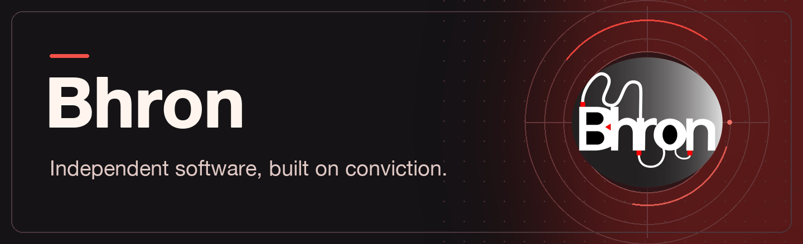

Bhron is the independent software studio of [Samir A Nader](https://bhron.org/about/). We build tools for focused browsing, offline dictation, and finding the source behind a claim.

[**Visit bhron.org**](https://bhron.org/) · [Latest releases and updates](https://bhron.org/updates/) · [Get in touch](mailto:info@bhron.org)

## Open source

<table>
  <tr>
    <td width="78" align="center"></td>
    <td><strong><a href="https://github.com/Bhron-LLC/ScreenFry">ScreenFry</a></strong> Browse with the parts you came for. Hide feeds, Shorts, and Reels, and set daily limits in Safari and Chrome on Mac. <a href="https://bhron.org/screenfry/">Get ScreenFry for Mac</a> · <a href="https://github.com/Bhron-LLC/ScreenFry/releases">Releases</a></td>
  </tr>
  <tr>
    <td width="78" align="center"></td>
    <td><strong><a href="https://github.com/Bhron-LLC/Handy/tree/feat/local-text-formatting">Handy · Bhron fork</a></strong> Offline dictation with spoken punctuation, optional capitalization, and numbers as digits. Based on <a href="https://github.com/cjpais/Handy">cjpais/Handy</a>. <a href="https://bhron.org/handy/">See what Bhron added</a> · <a href="https://github.com/Bhron-LLC/Handy/tree/feat/local-text-formatting">Formatting branch</a></td>
  </tr>
  <tr>
    <td width="78" align="center"></td>
    <td><strong><a href="https://github.com/Bhron-LLC/alfred-apple-passwords-apw">Apple Passwords for Alfred</a></strong> Search your Apple Passwords logins and 2FA codes from Alfred and copy or paste them into any app. Built on <a href="https://github.com/bendews/apw">apw</a>. <a href="https://github.com/Bhron-LLC/alfred-apple-passwords-apw/blob/main/Apple-Passwords-apw-community.alfredworkflow">Download the workflow</a> · <a href="https://bhron.org/productivity/#shelf">More Mac apps we vouch for</a></td>
  </tr>
  <tr>
    <td width="78" align="center"><a href="https://github.com/Bhron-LLC/alfred-direct-unit-converter"><b>37°C → °F</b></a></td>
    <td><strong><a href="https://github.com/Bhron-LLC/alfred-direct-unit-converter">Unit Converter: Direct Search for Alfred</a></strong> Type conversions like <code>37 c to f</code> or <code>10 km to miles</code> straight into Alfred, with no keyword. A companion to Alfred's official Unit Converter. <a href="https://github.com/Bhron-LLC/alfred-direct-unit-converter/raw/refs/heads/main/Unit-Converter-Direct-Search.alfredworkflow">Download the workflow</a> · <a href="https://bhron.org/productivity/#shelf">More Mac apps we vouch for</a></td>
  </tr>
  <tr>
    <td width="78" align="center"><a href="https://github.com/Bhron-LLC/alfred-hotcorner-toggle"><b>◳</b></a></td>
    <td><strong><a href="https://github.com/Bhron-LLC/alfred-hotcorner-toggle">Hot Corner toggle for Alfred</a></strong> Type <code>hotcorner</code> to switch the top-right Notification Center corner on or off. <a href="https://github.com/Bhron-LLC/alfred-hotcorner-toggle/raw/refs/heads/main/Toggle-Notification-Center-Hot-Corner.alfredworkflow">Download the workflow</a> · <a href="https://bhron.org/productivity/#shelf">More Mac apps we vouch for</a></td>
  </tr>
</table>

Bhron's Alfred workflows are open source under the MIT License, and the Handy fork keeps Handy's MIT License. ScreenFry's code is public but all rights are reserved. Details, credits and legal terms: [bhron.org/open-source](https://bhron.org/open-source/).

## More from Bhron

- **[R3fute](https://bhron.org/r3fute/)** maps debates around a yes-or-no question so you can follow each claim, objection, and reply.
- **[Bahath](https://bhron.org/bahath/)** finds the Quran verse or hadith you half remember and brings you back to the source text.
- **[ReelMeal](https://bhron.org/reelmeal/)** is an iOS app that uses a meal photo to estimate how the food was prepared, including whether heated seed oils were likely involved.

ScreenFry, R3fute, and Bahath were built with [Yasser Jaghoori of Unjam Labs](https://unjamlabs.com/).
